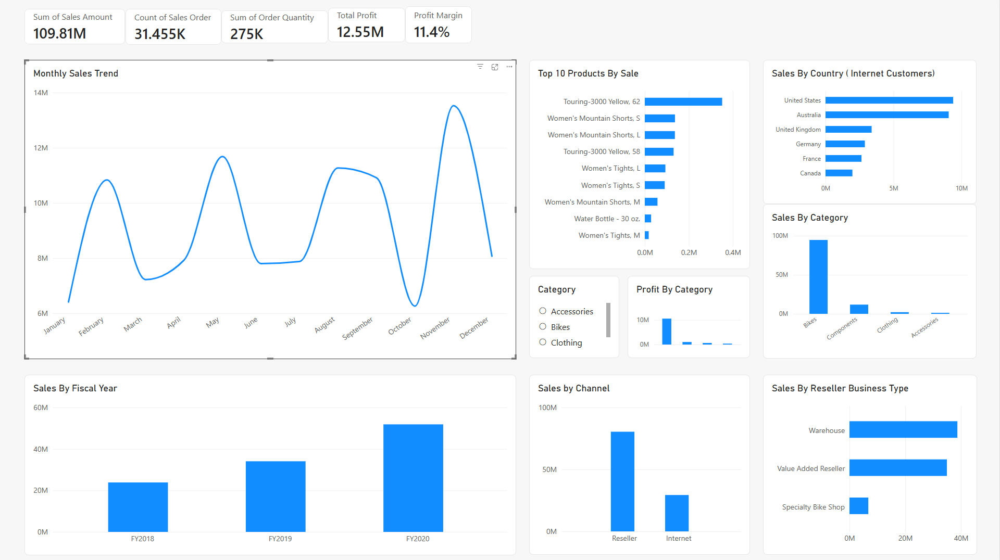

# AdventureWorks Sales Dashboard (Power BI)

An interactive Power BI dashboard analysing three years of AdventureWorks sales (July 2017 to June 2020). I built it to practise data modelling, DAX and dashboard design on a realistic multi-table dataset.



## Tools

- Power BI Desktop
- DAX (measures)
- Excel (source data)

## Dataset

Microsoft's official AdventureWorks Sales sample (Excel version), loaded as six related tables:

| Table | Purpose |
|---|---|
| `Sales_data` | Fact table. One row per product line within an order |
| `Sales_Order_data` | Order number and sales channel (Internet / Reseller) |
| `Product_data` | Product, subcategory, category |
| `Customer_data` | Customer geography (internet customers) |
| `Reseller_data` | Reseller name, business type, geography |
| `Date_data` | Calendar and fiscal year/quarter |

## Data model

Star schema with `Sales_data` at the centre. Relationships are many-to-one with single-direction filtering.

- `Sales_data[ProductKey]` to `Product_data[ProductKey]`
- `Sales_data[CustomerKey]` to `Customer_data[CustomerKey]`
- `Sales_data[ResellerKey]` to `Reseller_data[ResellerKey]`
- `Sales_data[SalesOrderLineKey]` to `Sales_Order_data[SalesOrderLineKey]`
- `Sales_data[OrderDateKey]` to `Date_data[DateKey]`

**Issue found and fixed:** Power BI did not auto-detect the date relationship, so every year showed the same total. Creating the `OrderDateKey` to `DateKey` relationship manually fixed the time-based analysis.

## DAX measures

```DAX
Total Profit =
SUM(Sales_data[Sales Amount]) - SUM(Sales_data[Total Product Cost])

Profit Margin =
DIVIDE([Total Profit], SUM(Sales_data[Sales Amount]))
```

Both measures recalculate with every slicer and filter selection (filter context).

## Dashboard contents

- **KPI cards:** Total Sales, Total Orders (distinct count of `SalesOrder`), Units Sold, Total Profit, Profit Margin
- Monthly sales trend
- Sales by fiscal year
- Sales and profit by product category
- Sales by channel (Internet vs Reseller)
- Sales by reseller business type
- Sales by country (internet customers)
- Top 10 products (Top N filter)
- Category slicer that filters the whole report

## Key findings

With all categories selected:

- **Total sales:** about $109.8M from 31,455 orders and 275K units
- **Profit:** about $12.55M, a margin of about 11.4%
- **Growth:** sales rose from about $23M in FY2018 to about $34M in FY2019 and about $51M in FY2020, roughly 50% year on year
- **Bikes dominate:** about 86% of revenue
- **Resellers drive most revenue:** the Reseller channel is much larger than Internet
- **Reseller types:** Warehouse and Value Added Resellers lead; Specialty Bike Shops are far smaller

## Data notes

- **Counting orders:** one order has several lines, so Total Orders uses a distinct count of `SalesOrder`, not a row count.
- **`[Not Applicable]` rows:** reseller sales have `CustomerKey = -1` and internet sales have `ResellerKey = -1`. I kept them in the data and filtered them out only on the visuals where they are not meaningful.
- **Country chart:** it uses customer location, so it covers Internet sales only. Components are sold only through resellers and do not appear in it.

## What I learned

- Why the grain of a fact table matters for counting
- Building and debugging relationships in a star schema
- Writing DAX measures and how filter context changes their results
- Using slicers, Top N filters and date fields in reports

## Files

- `AdventureWorks_Sales_Dashboard.pbix`: the Power BI report
- `dashboard.png`: dashboard screenshot
- Source data: [AdventureWorks Sales sample](https://github.com/microsoft/powerbi-desktop-samples/tree/main/AdventureWorks%20Sales%20Sample)
